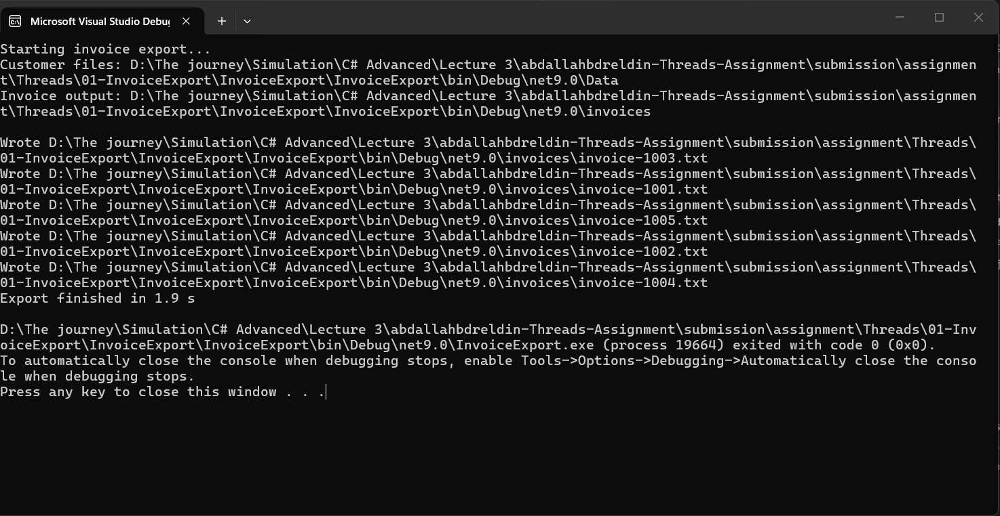

# Assignment 01 — Answers

Student name:  Abdullah Mostafa Bdreldin
Group / ID:  net/g-1

## Problems with the current design
 the program is synchronous so each operation block the current threed until it finishes delay , this includes simulated delays and I/O operations

 export finished in almost 6 seconds

 
-

## What you changed
 - truned the program into asynchronous especially the loop in ExportAllPendingAsync() method using Task.WhenAll as there is no need to block the threed until get order by order but instead we can get the orders concurrently
	- 
  export finsished in 2 seconds

  
-
