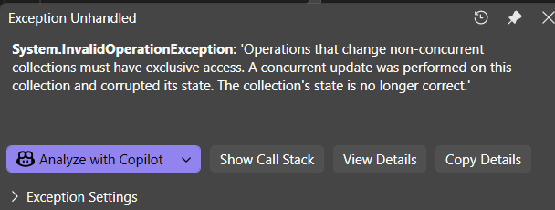
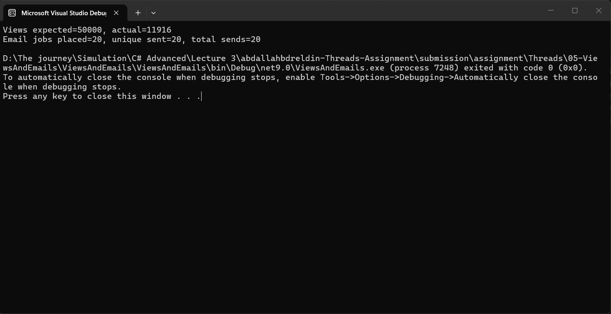
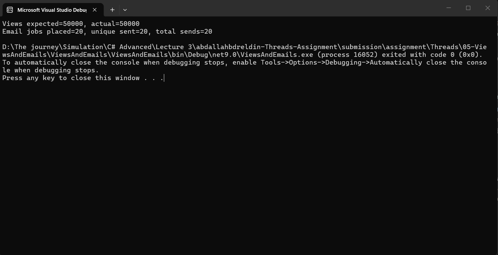

# Assignment 05 — Answers

Student name: Abdullah Mostafa Bdreldin
Group / ID: net/g-1

## Failures you observed

	- when many threads are trying to access the same collection,
	 it can lead to duplicated key exception because of race conditions.

	- even when using concurrent collections, it can lead to business-rule violations as result of lost updates, so the expected and actual may still be different.

## What you changed

	- using concurrent collections instead of non-concurrent collections to avoid duplicated key exception.
	- using try.addorupdate to handle lost updates and avoid business-rule violations.
	- using tasks instead of threads to avoid thread blocking.

## Collection safety vs business-rule safety

	- collection safety handle collection state and individual opertaions on the collection,
	- while business-rule safety handle the overall state of the collection and multiple operations and make sure the operation atomicity.
