# Order Processing System 

## Run the phases

From the repository root:

```powershell
cd OrderProcessing\OrderSystem
dotnet run -- phase1
dotnet run -- phase2
dotnet run -- phase3
dotnet run -- phase4
```

To demonstrate cancellation, pass a delay in milliseconds after the phase name, for example:

```powershell
dotnet run -- phase3 --cancel-after 1500
```

The current program defaults to `phase1` when no phase argument is supplied. The assignment also asks for a numbered menu; that menu is not currently implemented.

`JsonFileStore` creates its data directory at `AppContext.BaseDirectory\Data`. With the commands above, this is normally `OrderProcessing\OrderSystem\bin\Debug\net10.0\Data` (or the corresponding configuration directory, such as `Release`). `DataSeeder.ResetAsync()` recreates the sample data before a phase that resets its state.

## Project structure and class roles

| File/class | Role |
|---|---|
| `Program` | Parses the phase/cancellation arguments and starts the matching runner. |
| `JsonFileStore`, `IJsonFileStore` | JSON persistence API with synchronous and asynchronous operations. |
| `DataFiles` | Central names for all JSON data files. |
| `DataSeeder` | Recreates the initial sample data for a phase run. |
| `Customer`, `LoyaltyTier` | Customer profile and loyalty level. |
| `Product` | Product name, price, stock, and shipping weight. |
| `Coupon` | Coupon code, percentage discount, and expiration. |
| `Order`, `OrderItem`, `OrderStatus` | Order data, line items, and processing state. |
| `PaymentResult`, `PaymentTransaction`, `PaymentStatus` | Gateway response and persisted payment state. |
| `EmailMessage` | Confirmation email content, delivery attempts, and retry error. |
| `Report` | Aggregated order and sales statistics. |
| `CustomerDashboard` | Customer profile plus associated orders, payments, and emails. |
| `ShippingQuote` | Chosen carrier, price, and response duration. |
| `CustomerRepository`, `ProductRepository`, `CouponRepository` | Asynchronously load customer, product, and coupon data. |
| `IncomingOrderRepository`, `OrderRepository` | Read seeded incoming orders and persist processed orders. |
| `SyncCustomerRepository`, `SyncProductRepository`, `SyncCouponRepository` | Synchronous data access for Phase 1 comparison. |
| `ICustomerRepository`, `IProductRepository`, `ICouponRepository`, `IIncomingOrderRepository`, `IOrderRepository` | Repository contracts used by validation and order processing. |
| `RepositoryLatency`, `SyncRepositoryLatency` | Simulated asynchronous and blocking repository delays. |
| `SyncOrderValidator`, `OrderValidator` | Synchronous and asynchronous order validation. |
| `CustomerService` | Loads a customer or raises `CustomerNotFoundException`. |
| `InventoryService`, `ReserveStock` | Reserve and release inventory; `ReserveStock` also supports Phase 2 safe/unsafe race demonstrations. |
| `PricingService`, `OrderPricer` | Compute product subtotal, discount, shipping, and total; `OrderPricer` compares sequential and concurrent pricing. |
| `IPaymentGateway`, `PaymentGateway` | Simulate payment authorization, fraud checks, capture, and refunds. |
| `IEmailService`, `EmailService` | Send confirmation emails and retry transient SMTP failures. |
| `OrderProcessor`, `OrderProcessorV2` | Process checkout workflows for Phases 3 and 2, respectively. |
| `InvoiceGenerator` | Generate invoice output for completed Phase 2 orders. |
| `ReportGenerator` | Build the Phase 2 sales report. |
| `CustomerDashboardService` | Concurrently load the four customer dashboard data sets. |
| `IShippingCarrier`, `ShippingCarrier` | Carrier quote contract and simulated carrier implementation. |
| `ShippingQuoteService` | Select the first successful carrier quote or return the timeout flat rate. |
| `Phase1Runner`, `Phase2Runner`, `Phase3Runner`, `Phase4Runner` | Configure and execute each phase’s demonstrations. |
| `RaceConditionDemo`, `PricingComparisonDemo` | Phase 2 stock race/release and sequential-versus-concurrent pricing demonstrations. |
| `Log` | Timestamped, thread-labelled console logging. |
| `CustomerNotFoundException`, `InvalidCouponException`, `ShippingProviderUnavailableException`, `DatabaseWriteException`, `SmtpUnavailableException`, `DataFileCorruptedException` | Report expected domain, provider, persistence, and JSON errors. |

## Storage design

The store uses `System.Text.Json` with camelCase property names, indented output, and enums serialized as strings.
A collection is stored as a JSON array; for example, `orders.json` contains objects with fields such as `id`, `customerId`, `items`, `couponCode`, `totalAmount`, `status`, `failureReason`, and `transactionId`.

| File | Contents |
|---|---|
| `customers.json` | Customer profiles and loyalty tiers. |
| `products.json` | Product prices, stock, and weight. |
| `coupons.json` | Coupon codes, discounts, and expiry dates. |
| `incoming_orders.json` | Seed orders to process. |
| `orders.json` | Orders and their processing state. |
| `payments.json` | Captured, declined, and refunded payment transactions. |
| `emails.json` | Successfully sent confirmation emails. |
| `email_retry.json` | Emails that exhausted their retry attempts. |

`JsonFileStore` keeps a process-wide `SemaphoreSlim` for each full file path. Reads and writes to a file take its gate. `UpdateAsync` holds the gate for the entire read–modify–write operation, preventing concurrent updates from overwriting each other. Writes are serialized to a temporary file and then moved over the target file. This protects concurrent access within this application process; it is not a cross-process file lock.


## Console screenshots

### Phase 1

The screenshots below show the sync and async thread behavior and the phase summary graphic.

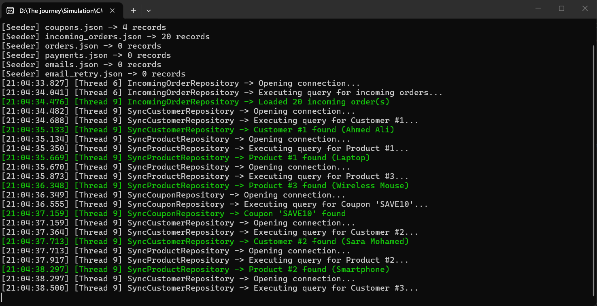
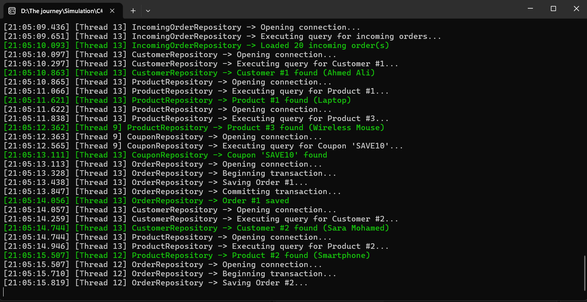
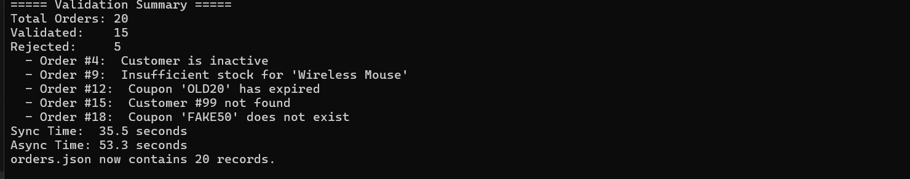

### Phase 2 and race-condition demo

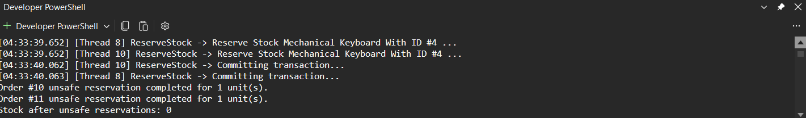
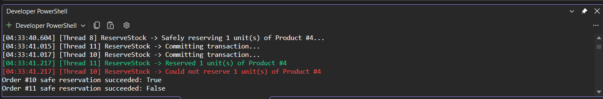
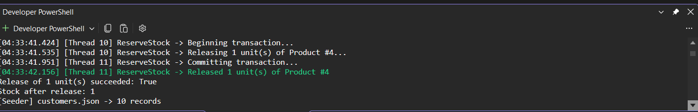
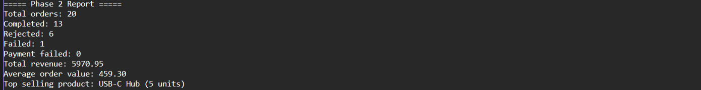

### Phase 3 checkout

This capture shows the payment timeout for order #5, the refund/failed-save outcome for order #13, and the final order statuses. The second capture shows the status totals.

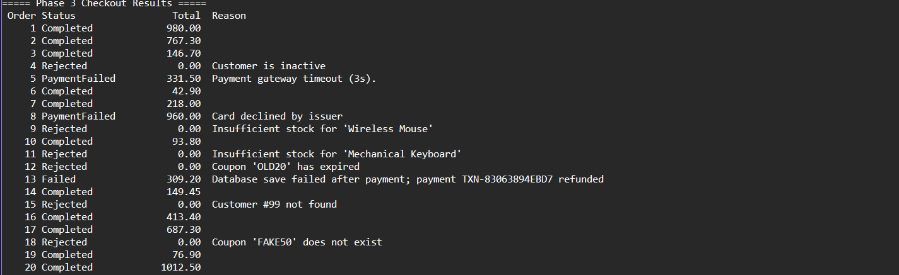
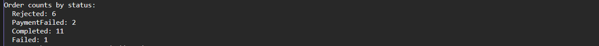

### Phase 4

The supplied captures show the shipping quote, fraud scoring, and email resend tasks.

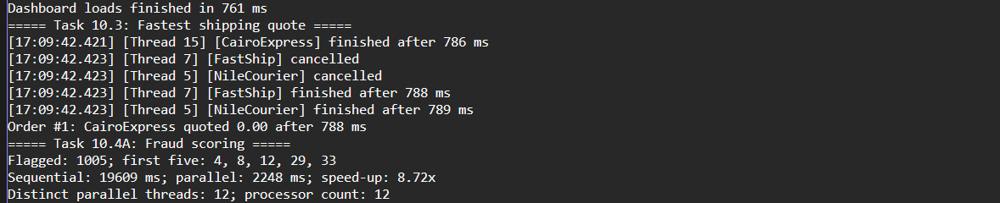
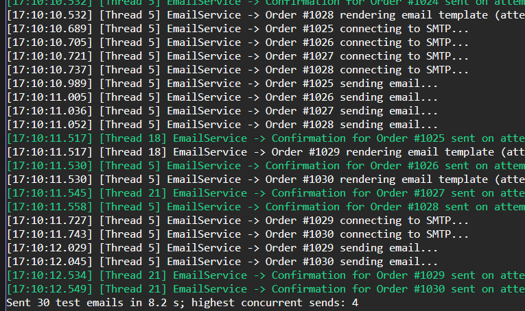

## Json File Store Design

# Overview

    Json File Store is responsible for reading and writing JSON files that are used to save the applications collections. It brings together file access, JSON serialization and JSON deserialization, error handling and synchronization.
    
    Each collection is saved as a JSON file inside the Data folder. The store uses System Text Json for serialization.
    
  # API Design
    
    The class offers methods for regular application tasks and synchronous methods, for comparing synchronous and asynchronous processing.
    
# Methods

   1)  Read Async <T>() :

    Converts a JSON file in an asynchronous way. Provides an instance of T if the file is not found.

   2) Write Async <T>() :

    Converts data and saves it to a JSON file in a way.

   3) Update Async <T>() :

    Carries out a read modify write action while keeping a lock on the file.

   4) Read <T>() :

    Reads and converts a JSON file in a way.

   5)  Write <T>() :

    Converts. Saves data in a synchronous way.

    

## Phase 1 comparison questions

1. **Why are the synchronous and asynchronous times almost the same when orders are awaited one after another?**  

   Both versions perform the same operations in sequence, and each operation waits for the same simulated latency.
   `await` lets the current thread do other work during an asynchronous wait,
   but it does not make this sequential run finish sooner by itself.

   note that : Async operations perform one more operation than the Sync operations (SaveOrder) so the async operation took more time .

2. **Is the thread ID before an `await` always the same as after it? Why?**  

   No. When an awaited operation is incomplete, the continuation can run on a different thread.
   A console application normally has no synchronization context that requires the continuation to return to its original thread.
   
   
   

3. **What does the thread do while `Task.Delay()` or `Thread.Sleep()` is waiting?**  

   During `Task.Delay()`, the method is suspended and the thread can run other work.
   During `Thread.Sleep()`, the current thread is blocked and cannot do other work until the sleep ends.

4. **Why should a repository method return `Task<T>` instead of `T`?**  

   A repository often waits for file, database, or network I/O. Returning `Task<T>` lets the caller await that operation without blocking its thread,
   and provides the eventual result as `T`.

5. **What is the difference between `File.ReadAllText` and `File.ReadAllTextAsync`? Does the async version occupy a thread while the disk is reading?**  

   `File.ReadAllText` blocks its caller until the whole file has been read.
   `File.ReadAllTextAsync` returns a task that can be awaited, so the caller's thread is not blocked while the I/O is pending.


## Phase 2: CPU-bound work and asynchronous I/O

Task.Run fits because its cpu bound so the threed pool thread is busy executing calculation ,
    but still no threed blocek , the threead is free to do another work as the calculation is moved to another thread.

calling database is a I/O bound, there is no need to still waiting 
the method suspended at await and the thread that was executing the method can return to the thraed pool to do another work

## Phase 2 questions

1) starting a task : telling the work to begin
   await task : wait until the task finished.

2) it's not neccessary to create new thread for every task , as the thread pool can reuse the thread to do another work,
 also some taks like I/O don't need thread while waiting.

 Task.Delay doesn't use the thread while waiting , when await it the method suspended , allowing the thread to do another work 

3) Result or Wait() block the current thread unitl the task completes

      
         public static void BlockingDemo()
        {
            Task task = Task.Delay(2000);

            task.Wait(); // Blocks the current thread for up to 2 seconds.

             Console.WriteLine("Task completed");
        }

4) when an exception thrown inseide task that never awaited , we will miss this exception as the exception is stored inside the task,
    we can cath it later by awaiting the task using try/catch

5) only use Task.Run for cpu bound tasks and avoid it for I/O bound tasks.

6) Task returns nothing , Task<T> return the value of type T when the task completes .

7) lock block cannt contain await because it's designed for synchronous operations and the lock must be release by the thread the acquired it.

8) the unprotected stock reservation caused overselling because there was individual lock over the file , lock for read and lock for write.

    solved by creating a lock through the while read,update and write operation using UpdateAsync method .


## Phase 2 questions

1) not neccessary , it just allow threads to do other work during the operation is waiting for response.

2) because the thread don't need to be blocked during waiting for response , so the application can handle many requests concurrently.

3) the application will handle the requests sequentially , so it takes huge time to process.

4) because there is no need to occupy the threads with just waiting calling database respone , async/await for I/O bound
 allow threads to do other work until task finishes.


## Phase 4 questions

1. Task 10.1 uses `Task.WhenEach` to print each checkout as it finishes.
 Task 10.2 uses `Task.WhenAll` to run the four dashboard loads together.
 Task 10.3 uses `Task.WhenAny` to choose the first successful shipping quote and continue after failed carriers.
 Task 10.4A uses `Parallel.ForEach` for CPU-bound scoring;
 10.4B uses `Parallel.ForEachAsync` for concurrent email I/O.

2.  Awaiting `Task.WhenAll(...)` throws when a load fails.
	Inspecting each faulted task’s `Exception` exposes every failure;
	the dashboard reports both the missing customer and payments timeout for customer #99.

3. Without cancellation, slower carriers keep waiting and doing work after a quote has been selected or the timeout has returned a flat rate.

4. Fraud scoring spends CPU time calculating each score, so multiple cores can calculate different orders at once.
  Email sending mostly waits for rendering and SMTP I/O,
  so asynchronous concurrency improves throughput without needing more CPU cores.

5. Task 10.4A runs CPU calculations in parallel across multiple threads.
  Task 10.1 starts asynchronous order workflows concurrently;
  while they wait for file and service I/O, their threads can do other work.

